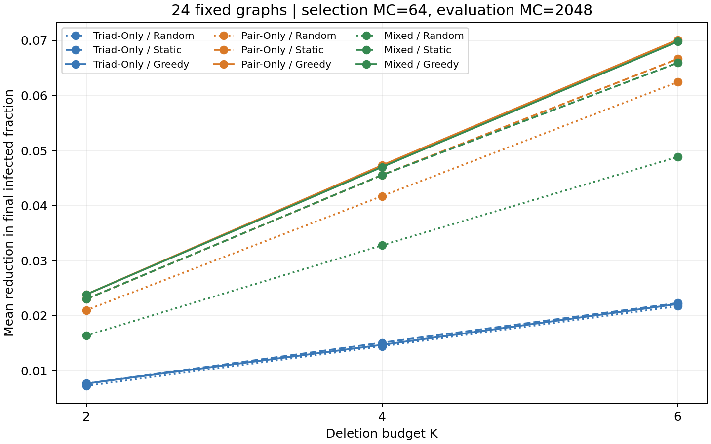

1.先运行 SIR 参数实验
用现有 sir.py，观察 \(F\)、\(\Delta_{\mathrm{HO}}\) 及不同三元超边的删除收益。确认动力学条件有效。

2.让 Codex 小幅修改综合数据生成入口
只修改现有 dataset.py，使 12 种生成器组合都能用于训练数据。生成 48 张小规模图。

3.先训练 DDQN，再训练 SAC
使用相同训练图、SIR 参数和计算预算，先训练约 200 Episode，画验证集 \(F_K\) 与训练进程的关系。

4.最后比较 HGNN 模块
在训练确认有明显学习效果后，比较 Full、No Pair 和 No Global Attention。只需要一组清楚的对照，不必增加很多无意义测试。

## 2026-11-19 任务结论：混合高阶网络的三种删边干预实验

本节对应任务“一次性完成混合高阶网络的三种删边干预实验”，结果目录为 [outputs/mixed_intervention_v1](outputs/mixed_intervention_v1/)。本次已完成基础检查、先导运行、完整比较、固定配额分配、组合非独立性分析、小规模精确搜索及传播参数敏感性分析。本次未训练强化学习模型，未修改 HGNN、DDQN 和 SAC。

### 实验配置与统计口径

- 主实验使用 24 张固定网络：ER、WS、SBM 与 Uniform、Overlap、Community、Heterogeneous 的 12 种组合，每种 2 张；每图 N=30、M2=60、M3=30，预算 K=2、4、6。
- 三种模式共享原始网络和评价随机条件：Triad-Only 仅删三元超边，Pair-Only 仅删二元边，Mixed 允许删除两类交互。两类交互独立存在，每条删除成本相同，所有删除均发生在传播开始前。
- 主 SIR 参数为 beta1=0.08、beta2=0.16、mu=0.20、rho0=0.10、max_steps=2000，沿用同步离散传播机制和配对共同随机数（CRN）。
- Static 和 Greedy 评分 MC=64，主实验最终评价 MC=2048；选择与最终评价使用独立种子。Random 每图每种模式抽取 20 条删除序列，复用 K=2、4、6 前缀。
- Random 先在图内平均，再进行图级 Bootstrap（2,000 次，95% CI），不把随机重复或传播轨迹当作独立网络样本。
- 6 张代表图按结构预先选定，先导图计入上述 24 张网络一次；未依据传播收益筛选网络。另用 2 张 N=12、M2=12、M3=8 的小图进行 K=3 精确枚举。

### 主结果：K=6

收益定义为 ΔF=F0−FK，数值单位为最终感染人口比例，越大越好。

| 干预模式 | Random 平均 ΔF | Static 平均 ΔF | Greedy 平均 ΔF |
|---|---:|---:|---:|
| Triad-Only | 0.021745 | 0.022302 | 0.022125 |
| Pair-Only | 0.062444 | 0.066648 | **0.070127** |
| Mixed | 0.048853 | 0.065941 | 0.069788 |

1. **二元删边在本次配置下具有更高的干预价值。** 三元贪心降低感染比例约 2.21 个百分点，二元贪心约 7.01 个百分点。三元删除并非无效，但其收益及选边策略间差异较小。
2. **混合贪心没有表现出超过仅删二元边的优势。** 混合贪心平均删除 5.958 条二元边，与 Pair-Only 的平均收益差为 −0.000339。六张代表图的固定配额实验中，平均收益从配额 (K2,K3)=(0,6) 的 0.021921 上升到 (6,0) 的 0.069466；这些结果是配额约束贪心结果，不能称为全局最优解。
3. **二元和混合动作下，序贯重新评分优于静态排序，但增益幅度有限。** Pair-Only 的 Greedy−Static 平均收益差为 0.003478，图级 95% CI 为 [0.001472, 0.005519]；Mixed 为 0.003847，CI 为 [0.001713, 0.006108]。Triad-Only 为 −0.000177，CI 为 [−0.000705, 0.000351]，没有明确优势。
4. **未观察到稳定、强烈的平均非加性收益。** 在六张代表图上，每种交互类型每图抽取 20 对，共 360 对，使用 MC=256 计算 J=联合收益−两条单独收益之和。Pair–Pair、Triad–Triad、Pair–Triad 的平均 J 分别为 0.000093、−0.000063、0.000036，三类图级 Bootstrap 区间均包含零。正、负估计值均保留；现有数据不足以认定存在系统性的跨阶协同。
5. **小图存在高于 Static、部分高于 Greedy 的组合。** 小型 SBM/Community 图的 Mixed 模式中，Static、Greedy、枚举集合经独立 MC=2048 评价的收益分别为 0.033732、0.041463、0.043457。枚举覆盖该模式全部 1,140 个三边删除集合，但其最佳集合仅对应 MC=128 的有限搜索目标，不能称为真实期望意义下的全局最优解。

### 参数敏感性：六张预先选定的代表图，K=6

下表为 Greedy 平均 ΔF。主条件引用已完成的 MC=2048 结果；其余条件的独立最终评价 MC=1024。各条件内共享评价 CRN。

| beta1 | beta2 | Triad-Only | Pair-Only | Mixed |
|---:|---:|---:|---:|---:|
| 0.08 | 0.16 | 0.021921 | 0.069466 | 0.069466 |
| 0.04 | 0.16 | 0.012788 | 0.026839 | 0.024333 |
| 0.08 | 0.32 | 0.040104 | 0.072331 | 0.072331 |
| 0.08 | 0.08 | 0.011930 | 0.066938 | 0.065462 |
| 0.08 | 0 | **0** | 0.064941 | 0.064941 |

增强三元传播会提高三元删除收益，但本次所有条件下，二元贪心平均收益仍高于三元贪心。弱二元传播条件下，混合贪心平均删除 4.667 条二元边，但收益未超过 Pair-Only。Greedy 相对 Random 的优势随传播条件和动作类型变化，并非总为正。beta2=0 时，仅三元删除的 132 条结果记录收益全部严格为零，二元删除仍然有效。

### 对后续 Q5 的建议及结论范围

建议将二元边纳入后续强化学习动作空间，并保留 Triad-Only 和 Pair-Only 对照。序贯策略的研究依据主要来自二元和混合 Greedy 相对 Static 的提升，以及小图枚举发现的更高收益组合；目前不足以把强跨阶协同作为前提。学习型策略可研究近似高收益删除方案、减少在线 SIR 搜索成本。

上述结论仅适用于本次生成器、网络规模、传播参数和相同单边删除成本。每种生成器组合只有 2 张图，敏感性与组合分析只覆盖 6 张代表图，且选边使用有限 MC；不能据此推断所有混合高阶网络或真实网络中二元边始终占优。

### 本任务输出文件

| 文件 | 内容 |
|---|---|
| [results.csv](outputs/mixed_intervention_v1/results.csv) | 4,752 条主实验记录，含删除序列、F0/FK、收益、峰值及计算资源 |
| [summary.csv](outputs/mixed_intervention_v1/summary.csv) | 540 条总体与结构分组汇总，含配对策略差及图级置信区间 |
| [allocation.csv](outputs/mixed_intervention_v1/allocation.csv) | 42 条固定配额贪心结果 |
| [interaction.csv](outputs/mixed_intervention_v1/interaction.csv) | 360 对交互的单边收益、联合收益、J 及共享节点信息 |
| [parameter_sensitivity.csv](outputs/mixed_intervention_v1/parameter_sensitivity.csv) | 1,980 条五种传播条件结果 |
| [exact_search.csv](outputs/mixed_intervention_v1/exact_search.csv) | 18 条小图 Static、Greedy、枚举集合的搜索与独立评价结果 |
| [run_config.json](outputs/mixed_intervention_v1/run_config.json) | 实际配置、随机种子、全部图结构、代码哈希和运行记录 |

五张实际数据图依次为：[干预比较](outputs/mixed_intervention_v1/figure_1_intervention_comparison.png)、[结构比较](outputs/mixed_intervention_v1/figure_2_structure_comparison.png)、[混合预算分配](outputs/mixed_intervention_v1/figure_3_mixed_allocation.png)、[交互非加性](outputs/mixed_intervention_v1/figure_4_interaction.png)、[参数敏感性](outputs/mixed_intervention_v1/figure_5_parameter_sensitivity.png)。

原模拟器一致性、双掩码独立性、CRN、零效应对照、结果完整性及缓存续跑检查均通过。共缓存 13,745,344 条唯一 SIR 轨迹计算。约 290 MB 的 `progress.sqlite` 为本地续跑中间缓存，未纳入 Git 提交；上述 CSV、图和配置构成本次发布结果。
